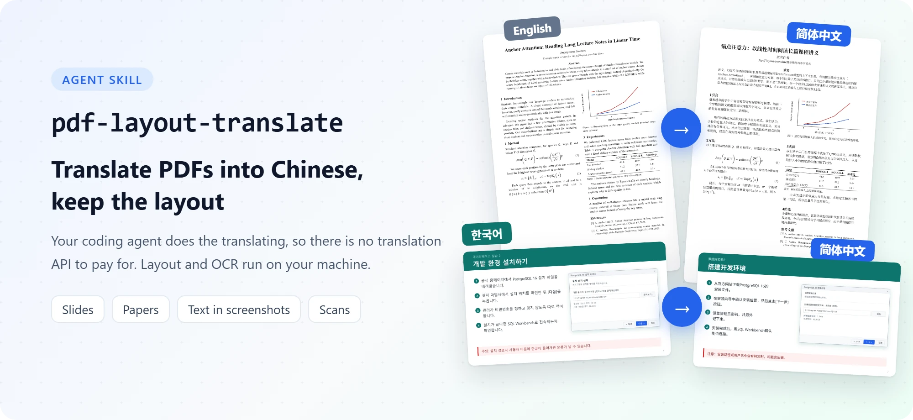
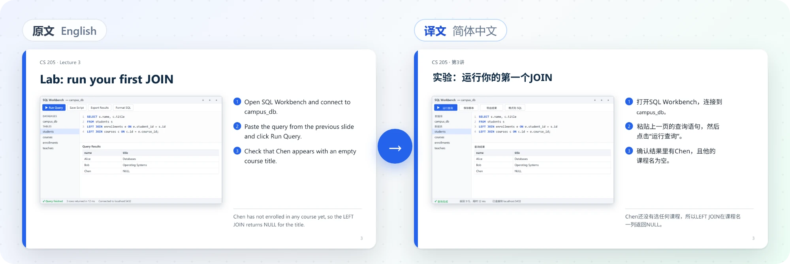
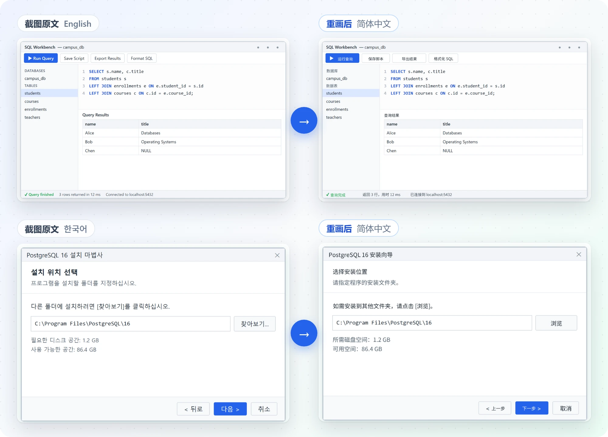
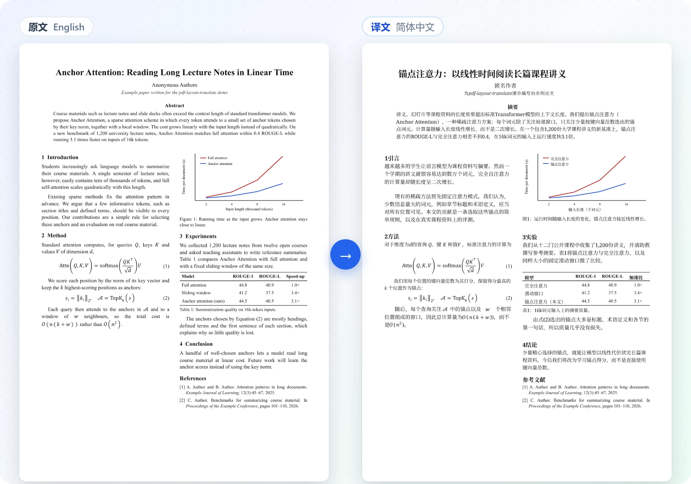
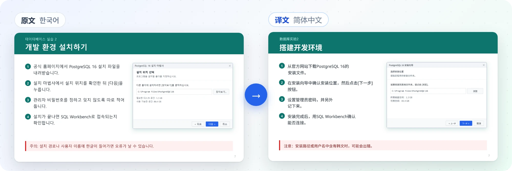
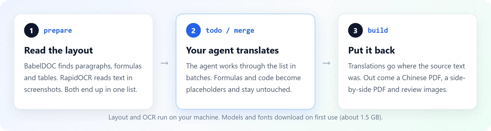

<p align="center">
  
</p>

<p align="center">
  <a href="#what-it-looks-like">Examples</a> ·
  <a href="#install">Install</a> ·
  <a href="#use">Use</a> ·
  <a href="examples/">Sample PDFs</a> ·
  <a href="README.md">简体中文</a>
</p>

<p align="center">
  <a href="LICENSE"></a>
  
  
  <a href="https://agentskills.io"></a>
  <a href="https://github.com/demo00dk/pdf-layout-translate/stargazers"></a>
</p>

pdf-layout-translate is an [Agent Skill](https://agentskills.io) that translates PDF slides, lecture notes and papers into Simplified Chinese. Each translation sits where the original text was, so the page count, layout, formulas and images stay the same. The skill also reads text inside screenshots, English or Korean for example, and redraws it in Chinese.

The AI agent you already use, such as Claude Code, Codex or Gemini CLI, does the translating, so you don't need a translation API. [BabelDOC](https://github.com/funstory-ai/BabelDOC) handles the layout and [RapidOCR](https://github.com/RapidAI/RapidOCR) reads the screenshots. Both run on your own machine.

## What it looks like

Every image below is real output of the skill. The source and translated PDFs are in [examples/](examples/) if you want to compare them yourself.

### Slides

Titles, steps and notes are in Chinese now; the SQL is untouched. The buttons and status bar in the screenshot on the left were translated as well.

<p align="center"></p>

### Text in screenshots

OCR reads each line of the screenshot. The agent translates only the interface text a person reads, and the skill draws the Chinese back in the original color and position. Code and table data stay as they are, so nothing gets broken.

<p align="center"></p>

### Papers

The two-column layout, inline and numbered equations, axis labels inside the chart and the three-rule table all stay in place. References are kept in the original language.

<p align="center"></p>

<details>
<summary>Korean slides</summary>
<br>
<p align="center"></p>
The source language is detected automatically. Korean, Japanese, French, German, Russian and others work; if the guess is wrong, set it with <code>--lang-in</code>.
</details>

## Why an agent does the translating

A common setup sends paragraphs to a translation API one at a time, and each one arrives without context. An agent can read the whole document first, settle on terminology, and decide what to leave alone: code, commands, names, references. For the next handout of the same course, `--carry-from` reuses the translations you already agreed on.

Every build also writes per-page comparison images. The agent looks through them, and if text overflows its box or something was missed, it fixes the translation and builds again.

## How it works

<p align="center"></p>

1. `prepare` parses the layout with BabelDOC and lists the paragraphs to translate. Formulas, code and special symbols become placeholders like `{v1}` that the translation keeps as they are. Images go through RapidOCR (PP-OCRv5), and every line it reads joins the same list.
2. The agent pulls the list in batches with `todo` and writes the translations back with `merge`.
3. `build` places each translation where its source was. It erases the text in screenshots and redraws it in Chinese, then writes a Chinese PDF, a side-by-side PDF and the comparison images.

PDFs from different tools have different quirks, so they get different treatment. Keynote draws inline math at the end of the content stream and leaves clipped hidden text behind. Google Slides and PowerPoint exports need their lists and table cells split apart. LaTeX papers keep their paragraph structure. Scans have no text layer, so whole pages go through OCR.

## Install

Any agent that supports Agent Skills (`SKILL.md`) and can run shell commands will work: Claude Code, Codex CLI, Gemini CLI, Antigravity, OpenCode and others.

Get the repository first:

```bash
git clone https://github.com/demo00dk/pdf-layout-translate.git
```

Then pick one of these.

**Install script.** It finds the agents on your machine and copies the skill into each one's skills folder:

```bash
python install.py              # every agent it finds
python install.py --list       # show where it would install, change nothing
python install.py --agent codex --setup   # only Codex, and set up the runtime right away
```

**Claude Code plugin marketplace:**

```
/plugin marketplace add demo00dk/pdf-layout-translate
/plugin install pdf-layout-translate@pdf-layout-translate
```

<details>
<summary><b>By hand:</b> copy <code>skills/pdf-layout-translate</code> into your agent's skills folder</summary>
<br>

| Agent | Personal skills folder |
|---|---|
| Claude Code | `~/.claude/skills/` |
| Codex CLI | `~/.codex/skills/` (or `$CODEX_HOME/skills/`); it also reads `~/.agents/skills/` |
| Gemini CLI | `~/.gemini/skills/` |
| Antigravity | `~/.gemini/antigravity/skills/` |
| OpenCode | `~/.config/opencode/skills/` |

</details>

Start a new agent session afterwards so the skill gets loaded.

Supported systems: Windows x64 (Windows on ARM switches to x64 Python under emulation), macOS on Intel and Apple silicon, and glibc Linux on x86-64 or ARM64. Alpine and other musl systems won't work, because onnxruntime, which BabelDOC needs, has no musl build.

## First run

The first time you use it, the scripts install a private runtime: Python 3.12, BabelDOC, the layout model, fonts and OCR models. That's about 1.5 GB in a single folder, and it never touches your system Python. It needs internet and usually takes 5 to 15 minutes. If it gets interrupted, run it again and it picks up where it stopped. After that it works offline.

To install or check it ahead of time:

```bash
python skills/pdf-layout-translate/scripts/lt.py setup
python skills/pdf-layout-translate/scripts/lt.py check
```

<details>
<summary>Downloads, proxies and mirrors</summary>
<br>

All you need to start is Python 3.9 or newer. If [uv](https://github.com/astral-sh/uv) isn't installed, the script downloads a pinned official uv release, checks its sha256, and lets uv fetch Python 3.12.

The first setup contacts:

- GitHub, for uv and Python
- PyPI, for the packages
- Hugging Face or ModelScope, for BabelDOC's model and fonts; the OCR models come from ModelScope
- the google/fonts repository, for STIX Two on systems other than Windows (pinned and checksummed)

Behind a proxy, set `HTTPS_PROXY`. To use a PyPI mirror, set `UV_DEFAULT_INDEX`.

</details>

<details>
<summary>Where the runtime lives, and how to move it</summary>
<br>

| System | Default location |
|---|---|
| Windows | `%LOCALAPPDATA%\pdf-layout-translate` |
| macOS | `~/Library/Application Support/pdf-layout-translate` |
| Linux | `~/.local/share/pdf-layout-translate` |

Set `LT_HOME` to put it somewhere else, and `LT_JOBS` for the job folders. You can also drop a `config.local.json` into the skill folder:

```json
{"home": "D:/tools/plt", "jobs": "D:/tools/plt/jobs"}
```

Write Windows paths with forward slashes, or double every backslash.

</details>

<details>
<summary>Sandboxed agents and Windows security software</summary>
<br>

Some agents run in a sandbox by default, with no network and write access only to the workspace (Codex does this). For the first setup, either allow network access once or run `setup` yourself in a normal terminal. The runtime folder is written to on every run, so add it to the writable paths or point `LT_HOME` into the workspace.

On Windows, the anti-ransomware features of suites such as 360, Tencent PC Manager and Huorong may quietly kill a freshly downloaded Python while it rewrites PDF files. The scripts avoid the venv redirector that triggers this most often. If you still see `the runtime process was stopped before it finished`, add the two folders from that message to the suite's trusted list and run the same command again.

</details>

## Use

Tell your agent something like:

> Translate ~/Downloads/lecture3.pdf into Chinese, keep the layout, and save it in ~/Downloads/translated

The agent follows the steps in [SKILL.md](skills/pdf-layout-translate/SKILL.md), checks the comparison images at the end, and reports back. For a 16-page deck each layout pass takes about a minute; the rest is translation time, which depends on your agent.

What you get:

| File | Contents |
|---|---|
| `<name>.中文.pdf` | The Chinese version, same page count as the source |
| `<name>.中外对照.pdf` | Source and translation side by side |
| `review/p001.png` and so on | Per-page comparison images, in the job folder |

You can also run the steps yourself. `lt.py` lives in `skills/pdf-layout-translate/scripts/`, and the rules a translation has to follow are in [translation-guide.md](skills/pdf-layout-translate/references/translation-guide.md).

```bash
python lt.py prepare lecture.pdf --pages 1-5,8   # translate these pages, keep the rest as they are
python lt.py todo <job> --limit 60              # get the next batch
python lt.py merge <job> batch1.json            # write translations back
python lt.py build <job> --out translated       # produce the PDFs
```

Other useful `prepare` options: `--lang-in` sets the source language, `--profile` overrides the layout guess (keynote, slides, latex or generic), `--carry-from` reuses translations from earlier jobs, and `--no-images` skips images.

## Limitations

- The target language is always Simplified Chinese. Export PPTX and DOCX files to PDF first, and remove passwords from protected PDFs.
- List items that already span several lines in the source don't get a hanging indent after translation, and some paragraphs pick up a two-character first-line indent. Both come from BabelDOC's typesetting rules.
- Translations use a regular weight. The color of a whole paragraph usually survives; bold or italic on single words usually doesn't.
- Very small text in images (below roughly 10 pixels) may not be read completely. Lines that aren't read completely stay as they are.
- Chinese in screenshots is drawn at twice the resolution, so PDFs with many screenshots grow several times larger.

## Testing

```bash
python tests/smoke_test.py
```

It builds a small PDF with a list and a screenshot, runs the whole pipeline and checks the output.

## Uninstall

Delete the skill folder and the runtime folder. `lt.py check` shows where the runtime is.

## License and thanks

AGPL-3.0, because the skill calls and extends BabelDOC, which is AGPL-3.0 too. Third-party components are listed in [THIRD_PARTY_NOTICES.md](THIRD_PARTY_NOTICES.md).

Thanks to [BabelDOC](https://github.com/funstory-ai/BabelDOC) and [PDFMathTranslate](https://github.com/Byaidu/PDFMathTranslate), [RapidOCR](https://github.com/RapidAI/RapidOCR), [PaddleOCR](https://github.com/PaddlePaddle/PaddleOCR) and [PyMuPDF](https://github.com/pymupdf/PyMuPDF).
