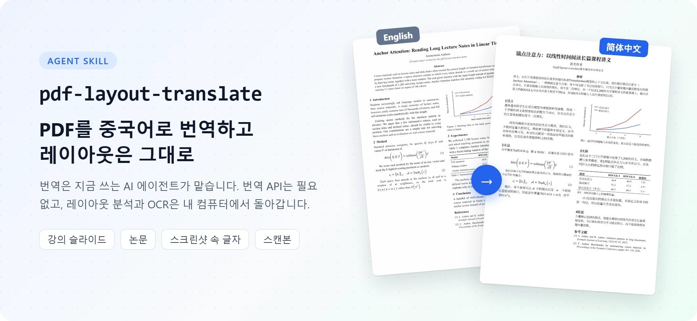
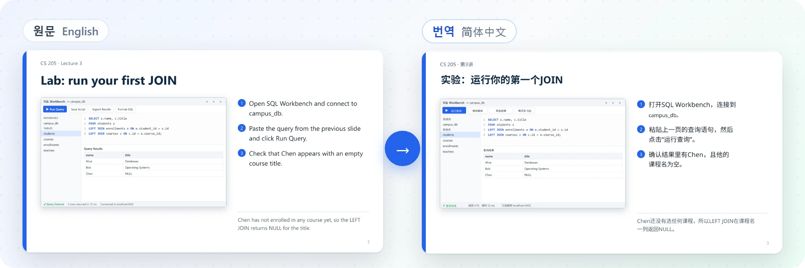
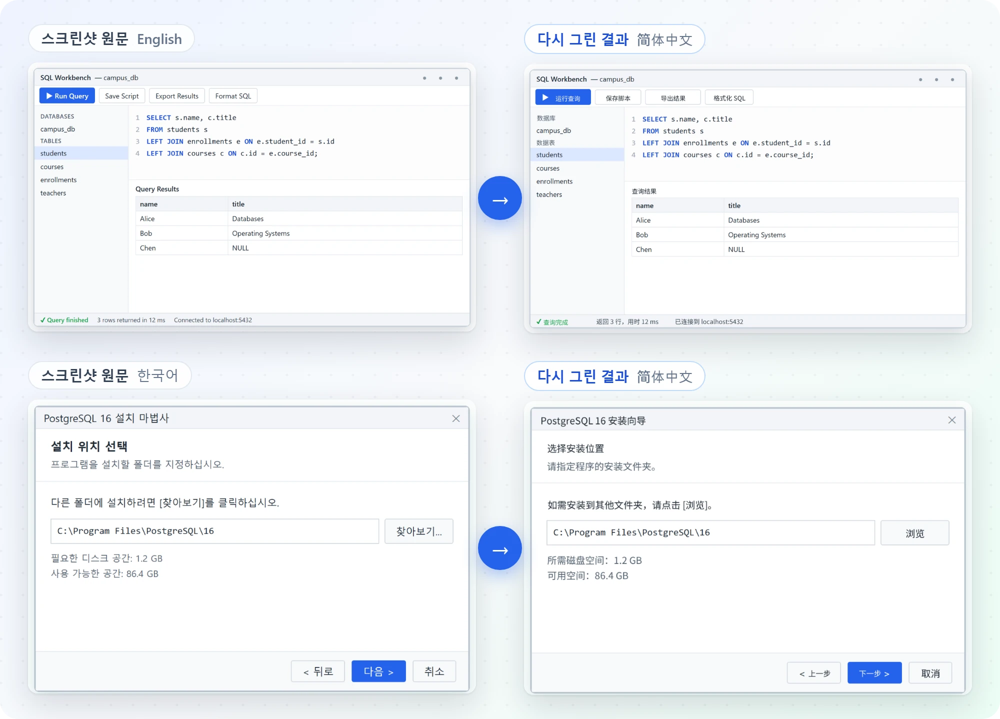
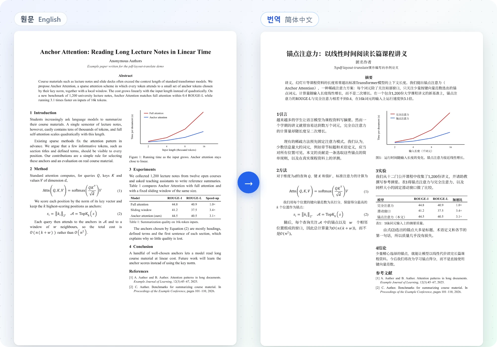
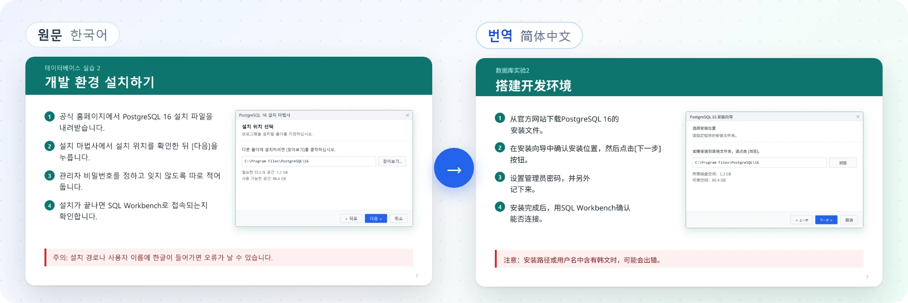
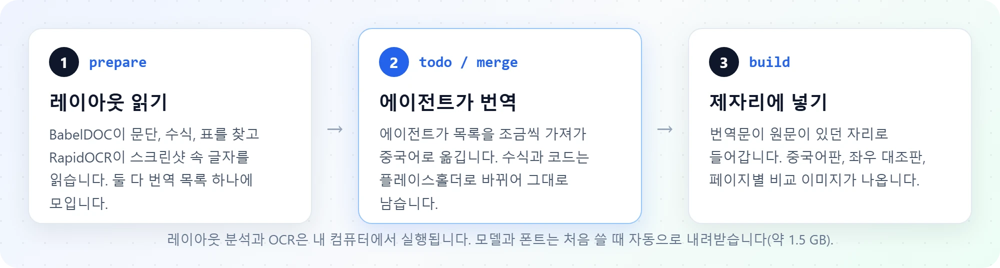

<p align="center">
  
</p>

<p align="center">
  <a href="#실제-결과">결과 보기</a> ·
  <a href="#설치">설치</a> ·
  <a href="#사용법">사용법</a> ·
  <a href="examples/">예제 PDF</a> ·
  <a href="README.md">简体中文</a> ·
  <a href="README.en.md">English</a>
</p>

<p align="center">
  <a href="LICENSE"></a>
  
  
  <a href="https://agentskills.io"></a>
  <a href="https://github.com/demo00dk/pdf-layout-translate/stargazers"></a>
</p>

pdf-layout-translate는 PDF 강의 슬라이드, 강의 노트, 논문을 간체 중국어로 번역하는 [Agent Skill](https://agentskills.io)입니다. 번역문은 원문이 있던 자리에 그대로 들어가서 쪽수, 레이아웃, 수식, 그림이 바뀌지 않습니다. 스크린샷 속 영어나 한국어도 읽어서 중국어로 다시 그려 넣습니다.

번역은 지금 쓰고 있는 AI 에이전트(Claude Code, Codex, Gemini CLI 등)가 하니까 번역 API를 따로 쓸 필요가 없습니다. 레이아웃은 [BabelDOC](https://github.com/funstory-ai/BabelDOC)이, 스크린샷 글자는 [RapidOCR](https://github.com/RapidAI/RapidOCR)이 맡고, 둘 다 내 컴퓨터에서 돌아갑니다.

## 실제 결과

아래 이미지는 전부 이 스킬이 실제로 만든 결과물입니다. 원문과 번역본 PDF는 [examples/](examples/)에 있으니 직접 열어서 비교해 봐도 됩니다.

### 강의 슬라이드

제목, 단계 설명, 메모는 중국어로 바뀌었고 SQL 코드는 그대로입니다. 왼쪽 스크린샷 속 버튼과 상태 표시줄도 같이 번역됐습니다.

<p align="center"></p>

### 스크린샷 속 글자

OCR이 스크린샷을 한 줄씩 읽습니다. 에이전트는 사람이 읽는 화면 문구만 번역하고, 스킬이 그 중국어를 원래 색과 위치에 다시 그립니다. 코드와 표 데이터는 망가지지 않게 손대지 않습니다.

<p align="center"></p>

### 논문

2단 레이아웃, 본문 속 수식과 번호 붙은 수식, 그래프의 축 이름, 가로선만 있는 표가 모두 제자리에 있습니다. 참고문헌은 원문 그대로 둡니다.

<p align="center"></p>

<details>
<summary>한국어 슬라이드</summary>
<br>
<p align="center"></p>
원문 언어는 자동으로 알아냅니다. 한국어, 일본어, 프랑스어, 독일어, 러시아어 등을 처리할 수 있고, 잘못 알아들었으면 <code>--lang-in</code>으로 직접 정해 주면 됩니다.
</details>

## 왜 에이전트가 번역하나

흔한 방식은 문단을 하나씩 번역 API에 보내는 건데, 그러면 문단마다 앞뒤 맥락이 없습니다. 에이전트는 문서 전체를 먼저 읽고 용어를 정한 다음, 코드나 명령어, 사람 이름, 참고문헌처럼 그대로 둘 부분을 가려냅니다. 같은 과목의 다음 자료를 번역할 때는 `--carry-from`으로 앞에서 정한 번역을 이어 쓸 수 있습니다.

빌드할 때마다 페이지별 비교 이미지도 나옵니다. 에이전트가 이걸 훑어보다가 글자가 상자 밖으로 넘치거나 빠진 번역이 보이면 고쳐서 다시 빌드합니다.

## 동작 방식

<p align="center"></p>

1. `prepare`는 BabelDOC으로 레이아웃을 분석해서 번역할 문단을 목록으로 뽑습니다. 수식, 코드, 특수 기호는 `{v1}` 같은 플레이스홀더로 바뀌고 번역할 때 그대로 남습니다. 이미지는 RapidOCR(PP-OCRv5)로 넘어가고, 읽어 낸 줄도 같은 목록에 들어갑니다.
2. 에이전트가 `todo`로 목록을 조금씩 가져가 번역하고, `merge`로 다시 써 넣습니다.
3. `build`는 번역문을 원문이 있던 자리에 넣습니다. 스크린샷 속 글자는 지운 다음 중국어로 다시 그리고, 마지막에 중국어판 PDF, 좌우 대조 PDF, 비교 이미지를 만듭니다.

PDF는 만든 프로그램마다 버릇이 달라서 따로 처리합니다. Keynote는 본문 속 수식을 콘텐츠 스트림 맨 끝에 가서야 그리고, 잘려서 안 보이는 텍스트도 남겨 둡니다. Google Slides와 PowerPoint에서 내보낸 PDF는 목록과 표 셀을 나눠 줘야 합니다. LaTeX 논문은 원래 문단 구조를 유지합니다. 스캔본은 텍스트 레이어가 없어서 페이지 전체를 OCR로 읽습니다.

## 설치

Agent Skills(`SKILL.md`)를 지원하고 셸 명령을 실행할 수 있는 에이전트라면 다 됩니다. Claude Code, Codex CLI, Gemini CLI, Antigravity, OpenCode 같은 것들입니다.

먼저 저장소를 받습니다.

```bash
git clone https://github.com/demo00dk/pdf-layout-translate.git
```

그다음 아래 방법 중 하나를 고르세요.

**설치 스크립트.** 내 컴퓨터에 있는 에이전트를 찾아서 각각의 스킬 폴더에 복사합니다.

```bash
python install.py              # 찾은 에이전트 전부에 설치
python install.py --list       # 어디에 설치할지만 보여 주고 아무것도 바꾸지 않음
python install.py --agent codex --setup   # Codex에만 설치하고 실행 환경도 바로 준비
```

**Claude Code 플러그인 마켓플레이스:**

```
/plugin marketplace add demo00dk/pdf-layout-translate
/plugin install pdf-layout-translate@pdf-layout-translate
```

<details>
<summary><b>직접 설치:</b> <code>skills/pdf-layout-translate</code>를 에이전트의 스킬 폴더에 복사</summary>
<br>

| 에이전트 | 개인 스킬 폴더 |
|---|---|
| Claude Code | `~/.claude/skills/` |
| Codex CLI | `~/.codex/skills/`(또는 `$CODEX_HOME/skills/`), `~/.agents/skills/`도 읽음 |
| Gemini CLI | `~/.gemini/skills/` |
| Antigravity | `~/.gemini/antigravity/skills/` |
| OpenCode | `~/.config/opencode/skills/` |

</details>

설치한 다음에는 에이전트 세션을 새로 열어야 스킬을 불러옵니다.

지원하는 시스템은 Windows x64(Windows on ARM에서는 x64 Python을 에뮬레이션으로 실행), Intel과 Apple 실리콘 macOS, x86-64와 ARM64의 glibc 리눅스입니다. Alpine 같은 musl 시스템에서는 쓸 수 없습니다. BabelDOC에 필요한 onnxruntime에 musl 빌드가 없어서입니다.

## 처음 실행할 때

처음 쓰면 스크립트가 전용 실행 환경을 설치합니다. Python 3.12, BabelDOC, 레이아웃 모델, 폰트, OCR 모델을 합쳐 약 1.5 GB이고, 전부 한 폴더에 들어가며 시스템 Python은 건드리지 않습니다. 인터넷이 필요하고 보통 5분에서 15분쯤 걸립니다. 중간에 끊기면 다시 실행하세요. 멈춘 곳부터 이어서 설치합니다. 다 깔고 나면 오프라인에서도 쓸 수 있습니다.

미리 설치하거나 상태를 확인하려면:

```bash
python skills/pdf-layout-translate/scripts/lt.py setup
python skills/pdf-layout-translate/scripts/lt.py check
```

<details>
<summary>다운로드 출처, 프록시, 미러</summary>
<br>

시작하는 데 필요한 건 Python 3.9 이상뿐입니다. [uv](https://github.com/astral-sh/uv)가 없으면 버전을 고정한 공식 uv를 내려받아 sha256을 확인하고, 그 uv로 Python 3.12를 가져옵니다.

처음 설치할 때 접속하는 곳:

- GitHub: uv와 Python
- PyPI: 패키지
- Hugging Face 또는 ModelScope: BabelDOC 모델과 폰트. OCR 모델은 ModelScope에서 받습니다
- google/fonts 저장소: Windows가 아닌 시스템에서 쓰는 STIX Two 폰트(버전 고정, 체크섬 확인)

프록시를 거쳐야 하면 `HTTPS_PROXY`를, PyPI 미러를 쓰려면 `UV_DEFAULT_INDEX`를 설정하세요.

</details>

<details>
<summary>실행 환경 위치와 옮기는 방법</summary>
<br>

| 시스템 | 기본 위치 |
|---|---|
| Windows | `%LOCALAPPDATA%\pdf-layout-translate` |
| macOS | `~/Library/Application Support/pdf-layout-translate` |
| Linux | `~/.local/share/pdf-layout-translate` |

`LT_HOME`으로 다른 곳에 둘 수 있고, 작업 폴더는 `LT_JOBS`로 바꿉니다. 스킬 폴더에 `config.local.json`을 넣어도 됩니다.

```json
{"home": "D:/tools/plt", "jobs": "D:/tools/plt/jobs"}
```

Windows 경로는 슬래시(/)로 쓰거나 역슬래시를 두 번씩 쓰세요.

</details>

<details>
<summary>샌드박스 안의 에이전트와 Windows 보안 프로그램</summary>
<br>

어떤 에이전트는 기본으로 샌드박스 안에서 돌아서 네트워크를 못 쓰고 작업 공간에만 쓸 수 있습니다(Codex가 그렇습니다). 처음 설치할 때는 네트워크를 한 번 허용하거나, 평소 쓰는 터미널에서 직접 `setup`을 실행하세요. 실행 환경 폴더에는 실행할 때마다 쓰기가 일어나니 쓰기 허용 경로에 넣거나 `LT_HOME`을 작업 공간 안으로 잡아야 합니다.

Windows에서는 360, Tencent PC Manager, Huorong 같은 보안 프로그램의 랜섬웨어 방어 기능이, 방금 내려받은 Python이 PDF를 고쳐 쓰는 걸 보고 프로세스를 조용히 끝내 버릴 수 있습니다. 스크립트는 이 문제를 가장 자주 일으키는 venv 런처를 거치지 않습니다. 그래도 `the runtime process was stopped before it finished`가 뜨면 메시지에 나온 폴더 두 개를 보안 프로그램의 신뢰 목록에 넣고 같은 명령을 다시 실행하세요.

</details>

## 사용법

에이전트에게 이렇게 말하면 됩니다.

> ~/Downloads/lecture3.pdf를 중국어로 번역해 줘. 레이아웃은 그대로 두고 ~/Downloads/translated에 저장해.

에이전트는 [SKILL.md](skills/pdf-layout-translate/SKILL.md)에 적힌 순서대로 진행하고, 마지막에 비교 이미지를 확인한 뒤 결과를 알려 줍니다. 16쪽짜리 슬라이드라면 레이아웃 처리가 두 번, 한 번에 1분 정도 걸립니다. 나머지는 번역 시간이라 에이전트 속도에 달렸습니다.

나오는 파일:

| 파일 | 내용 |
|---|---|
| `<이름>.中文.pdf` | 중국어판. 쪽수는 원문과 같음 |
| `<이름>.中外对照.pdf` | 원문과 번역문을 좌우로 나란히 |
| `review/p001.png` 등 | 페이지별 비교 이미지. 작업 폴더에 저장 |

단계를 직접 실행해도 됩니다. `lt.py`는 `skills/pdf-layout-translate/scripts/`에 있고, 번역할 때 지켜야 할 규칙은 [translation-guide.md](skills/pdf-layout-translate/references/translation-guide.md)에 있습니다.

```bash
python lt.py prepare lecture.pdf --pages 1-5,8   # 이 쪽들만 번역하고 나머지는 원문 유지
python lt.py todo <job> --limit 60              # 다음 묶음 가져오기
python lt.py merge <job> batch1.json            # 번역문 써 넣기
python lt.py build <job> --out translated       # PDF 만들기
```

`prepare`에서 자주 쓰는 옵션도 있습니다. `--lang-in`은 원문 언어를 정하고, `--profile`은 레이아웃 종류를 직접 고를 때(keynote, slides, latex, generic), `--carry-from`은 이전 작업의 번역을 다시 쓸 때, `--no-images`는 이미지를 건너뛸 때 씁니다.

## 한계

- 번역 결과는 간체 중국어로만 나옵니다. PPTX와 DOCX는 먼저 PDF로 내보내고, 암호가 걸린 PDF는 암호를 풀어 주세요.
- 원문에서 이미 여러 줄에 걸친 목록 항목은 번역 후 내어쓰기가 맞지 않고, 일부 문단에는 두 글자짜리 첫 줄 들여쓰기가 들어갑니다. 둘 다 BabelDOC의 조판 규칙에서 나옵니다.
- 번역문은 보통 굵기로 통일됩니다. 문단 전체의 색은 대개 남지만, 단어 몇 개에만 준 굵게나 기울임은 대개 사라집니다.
- 이미지 속 아주 작은 글자(대략 10픽셀 미만)는 다 못 읽을 수 있습니다. 다 읽지 못한 줄은 원래대로 둡니다.
- 스크린샷의 중국어는 두 배 해상도로 다시 그리기 때문에 스크린샷이 많은 PDF는 몇 배로 커집니다.

## 테스트

```bash
python tests/smoke_test.py
```

목록과 스크린샷이 들어간 작은 PDF를 만들어 전체 과정을 돌린 다음 결과물을 확인합니다.

## 삭제

스킬 폴더와 실행 환경 폴더를 지우면 끝입니다. 실행 환경이 어디 있는지는 `lt.py check`로 볼 수 있습니다.

## 라이선스와 감사의 말

AGPL-3.0입니다. 이 스킬이 같은 AGPL-3.0인 BabelDOC을 불러 쓰고 확장하기 때문입니다. 서드파티 구성 요소는 [THIRD_PARTY_NOTICES.md](THIRD_PARTY_NOTICES.md)에 정리해 두었습니다.

[BabelDOC](https://github.com/funstory-ai/BabelDOC), [PDFMathTranslate](https://github.com/Byaidu/PDFMathTranslate), [RapidOCR](https://github.com/RapidAI/RapidOCR), [PaddleOCR](https://github.com/PaddlePaddle/PaddleOCR), [PyMuPDF](https://github.com/pymupdf/PyMuPDF)에 감사드립니다.
