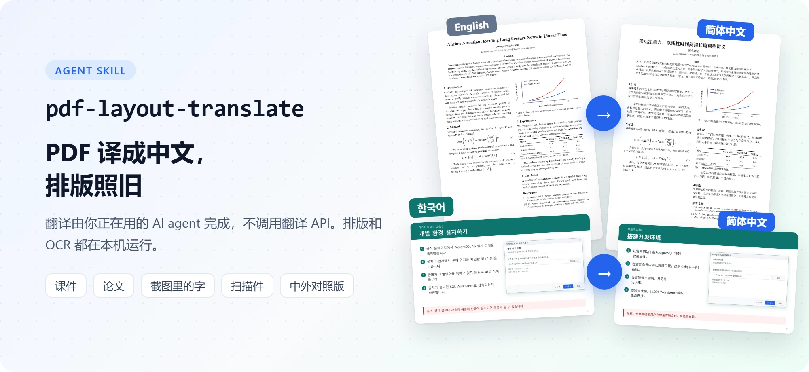
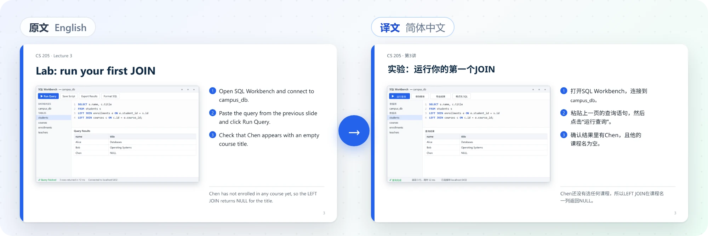
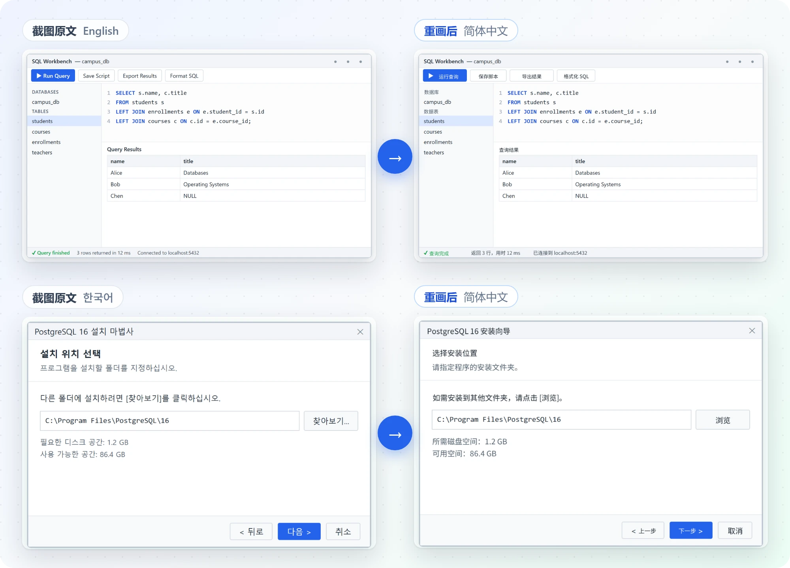
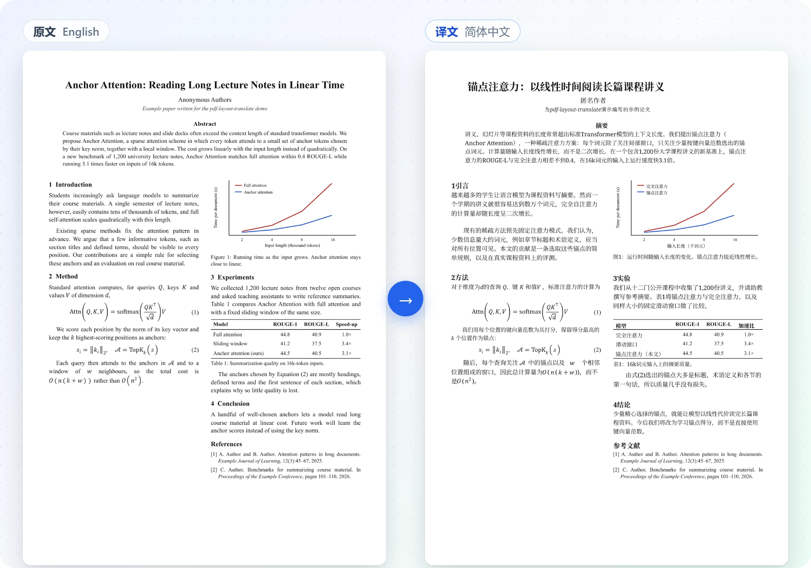
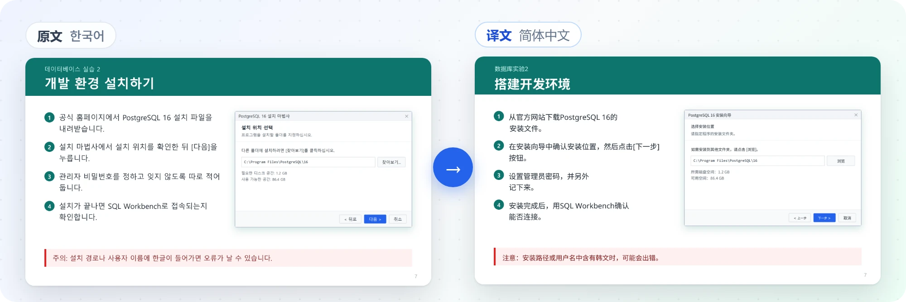
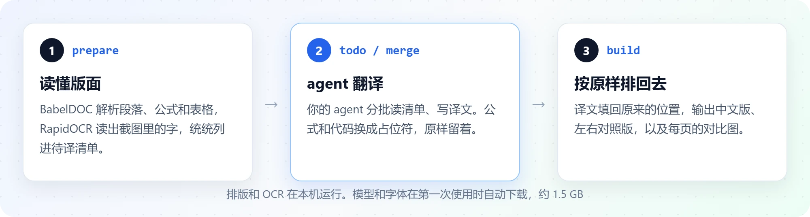

<p align="center">
  
</p>

<p align="center">
  <a href="#效果">效果</a> ·
  <a href="#安装">安装</a> ·
  <a href="#用法">用法</a> ·
  <a href="examples/">示例 PDF</a> ·
  <a href="README.en.md">English</a> ·
  <a href="README.ko.md">한국어</a>
</p>

<p align="center">
  <a href="LICENSE"></a>
  
  
  <a href="https://agentskills.io"></a>
  <a href="https://github.com/demo00dk/pdf-layout-translate/stargazers"></a>
</p>

pdf-layout-translate 是一个 [Agent Skill](https://agentskills.io)。它把 PDF 课件、讲义和论文译成简体中文，译文留在原文所在的位置，页数、版式、公式和图片都不变。截图里的英文、韩文也会被识别出来，换成中文画回原处。

翻译交给你正在用的 AI agent，比如 Claude Code、Codex 或 Gemini CLI，不用另外申请翻译 API。排版用的是 [BabelDOC](https://github.com/funstory-ai/BabelDOC)，截图文字靠本机的 [RapidOCR](https://github.com/RapidAI/RapidOCR) 识别，这两步都在你自己的电脑上跑。

## 效果

下面几张图都是这个技能实际跑出来的，原文和译文 PDF 放在 [examples/](examples/)，可以下载对照着看。

### 课件

标题、步骤和备注换成了中文，SQL 代码没动。左边那张软件截图里的按钮和状态栏也一起译了。

<p align="center"></p>

### 截图里的字

OCR 先读出截图里的每一行，agent 只翻译界面上给人看的文字，再按原来的颜色和位置画回去。代码和表格里的数据保持原样，免得改坏。

<p align="center"></p>

### 论文

双栏排版、行内公式和编号公式、图里的坐标轴文字、三线表都在原处。参考文献保持原文。

<p align="center"></p>

<details>
<summary>韩文课件</summary>
<br>
<p align="center"></p>
源语言会自动判断。韩文、日文、法文、德文、俄文等都能处理，判断错了可以用 <code>--lang-in</code> 指定。
</details>

## 为什么让 agent 来翻译

常见的做法是把段落一条条发给翻译 API，每条都看不到上下文。agent 可以先读完整份资料，再决定术语怎么译，哪些内容该原样保留：代码、命令、人名、参考文献。同一门课的下一份课件，可以用 `--carry-from` 沿用上一份已经定下来的译法。

每次生成完都会输出逐页对比图。agent 会看一遍，遇到文字挤出边框或者漏译的地方，改了再重新生成。

## 原理

<p align="center"></p>

1. `prepare` 用 BabelDOC 解析版面，列出要翻译的段落。公式、代码和特殊符号换成 `{v1}` 这样的占位符，翻译时原样保留。图片交给 RapidOCR（PP-OCRv5），读出来的每一行也进同一张清单。
2. agent 用 `todo` 分批取出清单，译完用 `merge` 写回。
3. `build` 把译文排回原来的位置。截图里的原文先擦掉，再画上中文。最后输出中文版、对照版和对比图。

不同软件导出的 PDF 有各自的毛病，所以分开处理。Keynote 把行内公式放在内容流的最后才画，还夹着被裁掉的隐藏文字；Google Slides 和 PowerPoint 要拆开列表和表格单元格；LaTeX 论文保持原来的段落结构。扫描件没有文字层，整页按图片识别。

## 安装

任何支持 Agent Skills（`SKILL.md`）、能执行命令的 agent 都能用，例如 Claude Code、Codex CLI、Gemini CLI、Antigravity、OpenCode。

先把仓库下载下来：

```bash
git clone https://github.com/demo00dk/pdf-layout-translate.git
```

然后任选一种方式安装。

**用安装脚本**。它会找到本机已有的 agent，把技能复制进各自的技能目录：

```bash
python install.py              # 装到所有找到的 agent
python install.py --list       # 只看会装到哪里
python install.py --agent codex --setup   # 只装 Codex，顺便把运行环境装好
```

**Claude Code 插件市场**：

```
/plugin marketplace add demo00dk/pdf-layout-translate
/plugin install pdf-layout-translate@pdf-layout-translate
```

<details>
<summary><b>手动安装</b>：把 <code>skills/pdf-layout-translate</code> 复制到 agent 的技能目录</summary>
<br>

| Agent | 个人技能目录 |
|---|---|
| Claude Code | `~/.claude/skills/` |
| Codex CLI | `~/.codex/skills/`（或 `$CODEX_HOME/skills/`），也读 `~/.agents/skills/` |
| Gemini CLI | `~/.gemini/skills/` |
| Antigravity | `~/.gemini/antigravity/skills/` |
| OpenCode | `~/.config/opencode/skills/` |

</details>

装好后新开一个 agent 会话，技能才会被加载。

支持的系统：Windows x64（Windows on ARM 会自动改用 x64 版 Python 模拟运行）、macOS（Intel 和 Apple 芯片）、Linux（x86-64 和 ARM64 的 glibc 发行版）。Alpine 这类 musl 系统用不了，因为 BabelDOC 依赖的 onnxruntime 没有 musl 版本。

## 第一次运行

第一次使用时，脚本会自动装一个私有运行环境：Python 3.12、BabelDOC、版面模型、字体和 OCR 模型，一共约 1.5 GB，全部放在同一个文件夹里，不碰系统自带的 Python。需要联网，一般 5 到 15 分钟。中途断了，重新运行会接着装。装完以后可以离线用。

想提前装好或者检查一下，可以手动运行：

```bash
python skills/pdf-layout-translate/scripts/lt.py setup
python skills/pdf-layout-translate/scripts/lt.py check
```

<details>
<summary>下载来源、代理和镜像</summary>
<br>

启动脚本只要求有 Python 3.9 以上。本机没有 [uv](https://github.com/astral-sh/uv) 时，会下载固定版本的官方 uv 并校验 sha256，再用它准备 Python 3.12。

首次安装会访问这些地址：

- GitHub：uv 和 Python
- PyPI：依赖包
- Hugging Face 或 ModelScope：BabelDOC 的模型和字体；OCR 模型来自 ModelScope
- google/fonts 仓库：在 Windows 以外的系统上下载 STIX Two 字体，版本固定并校验

要走代理就设置 `HTTPS_PROXY`。想用 PyPI 镜像就设置 `UV_DEFAULT_INDEX`，例如 `https://pypi.tuna.tsinghua.edu.cn/simple`。

</details>

<details>
<summary>运行环境装在哪里，怎么改</summary>
<br>

| 系统 | 默认位置 |
|---|---|
| Windows | `%LOCALAPPDATA%\pdf-layout-translate` |
| macOS | `~/Library/Application Support/pdf-layout-translate` |
| Linux | `~/.local/share/pdf-layout-translate` |

用环境变量 `LT_HOME` 可以换个位置，任务文件夹用 `LT_JOBS`。也可以在技能目录里放一个 `config.local.json`：

```json
{"home": "D:/tools/plt", "jobs": "D:/tools/plt/jobs"}
```

Windows 路径请写成正斜杠，或者把反斜杠写两遍。

</details>

<details>
<summary>沙箱里的 agent，以及 Windows 安全软件</summary>
<br>

有的 agent 默认跑在沙箱里，不能联网，只能写工作区，Codex 就是这样。这种情况下，第一次安装要么临时允许联网，要么先在你自己的终端里运行一次 `setup`。运行环境目录之后每次用都要写，得加进可写目录，或者把 `LT_HOME` 设到工作区里。

在 Windows 上，360、腾讯电脑管家、火绒这类软件的防勒索功能，可能会把刚下载的 Python 改写 PDF 的动作当成可疑行为，悄悄结束进程。脚本已经绕开了最容易被拦的 venv 启动器。如果还是报 `the runtime process was stopped before it finished`，把报错里列出的两个目录加进安全软件的信任区，再重跑同一条命令。

</details>

## 用法

在 agent 里直接说：

> 把 ~/Downloads/lecture3.pdf 翻译成中文，保留排版，放到 ~/Downloads/译文

agent 会按 [SKILL.md](skills/pdf-layout-translate/SKILL.md) 里的流程走完，最后看一遍对比图再告诉你结果。一份 16 页的课件，两遍排版各要一分钟左右，其余时间花在翻译上，快慢看 agent。

生成的文件：

| 文件 | 内容 |
|---|---|
| `<文件名>.中文.pdf` | 中文版，页数和原文一样 |
| `<文件名>.中外对照.pdf` | 原文和译文左右并排 |
| `review/p001.png` 等 | 逐页对比图，放在任务文件夹里 |

也可以自己一步步运行。`lt.py` 在 `skills/pdf-layout-translate/scripts/` 下，翻译时要遵守的规则写在 [translation-guide.md](skills/pdf-layout-translate/references/translation-guide.md)。

```bash
python lt.py prepare 课件.pdf --pages 1-5,8      # 只译这几页，其余页保留原文
python lt.py todo <任务文件夹> --limit 60          # 取出待译内容
python lt.py merge <任务文件夹> batch1.json        # 写回译文
python lt.py build <任务文件夹> --out 译文          # 生成成品
```

`prepare` 常用的参数还有 `--lang-in`（指定源语言）、`--profile`（版式判断错了时手动选 keynote、slides、latex 或 generic）、`--carry-from`（沿用以前任务的译文）和 `--no-images`（不处理图片）。

## 限制

- 只能译成简体中文。PPTX、DOCX 请先导出成 PDF，有密码的 PDF 请先去掉密码。
- 原文里本来就占好几行的列表项，译成中文后换行不会悬挂对齐；有些段落还会被加上两字首行缩进。这两点是 BabelDOC 的排版规则。
- 译文统一用常规字重。整段的颜色一般能保留，原文里个别词的粗体、斜体通常保留不下来。
- 图片里很小的字（大约 10 像素以下）可能认不全，认不全的那一行会保持原样。
- 截图里的中文按 2 倍分辨率重画，截图多的 PDF 会变大好几倍。

## 测试

```bash
python tests/smoke_test.py
```

它会生成一份带列表和截图的小 PDF，把整个流程跑一遍，再检查成品。

## 卸载

删掉技能文件夹和运行环境文件夹就行。运行环境在哪里，可以用 `lt.py check` 查看。

## 许可与致谢

本项目以 [AGPL-3.0](LICENSE) 发布，因为它调用并扩展了同为 AGPL-3.0 的 BabelDOC。用到的第三方组件见 [THIRD_PARTY_NOTICES.md](THIRD_PARTY_NOTICES.md)。

感谢 [BabelDOC](https://github.com/funstory-ai/BabelDOC) 和 [PDFMathTranslate](https://github.com/Byaidu/PDFMathTranslate)、[RapidOCR](https://github.com/RapidAI/RapidOCR)、[PaddleOCR](https://github.com/PaddlePaddle/PaddleOCR)、[PyMuPDF](https://github.com/pymupdf/PyMuPDF)。
